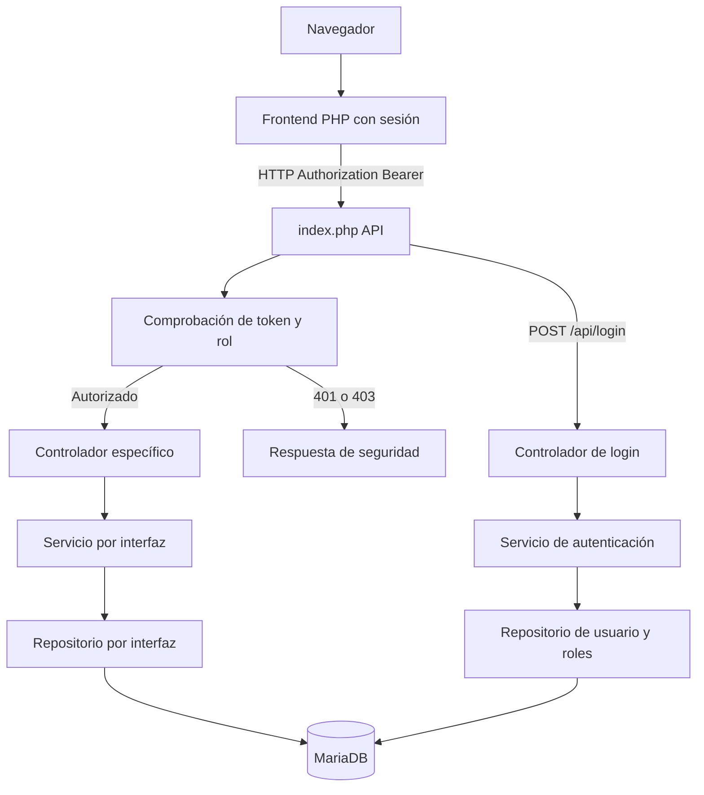

# Plan técnico — v3: Seguridad (Investigación)

> **Estado:** propuesta revisada con el Spec Kit V2 recibido (29-10-2026). El DDL del script entregado se cotejó y quedó resuelto en C1; resolver C3–C11 y cotejar el código integrado y el estado de la BD en ejecución. C2 está documentado, aún requiere prueba de regresión. No modificar V1/V2 cerradas a ciegas.

> **Evidencia de ejecución al 12-11-2026:** alta CLI del administrador ya efectuada; `POST /api/login` con JWT HS256 de **60 minutos** funcional (15/15 pruebas automatizadas y HTTP 200 real). Middleware integrado antes de los controladores: 28/28 pruebas automatizadas; GET real sin Bearer → 401 y con Bearer de `ADMIN` → 200 sobre `area_conocimiento`. Véanse `REGISTRO_FASE1_ADMIN.md`, `REGISTRO_FASE2_LOGIN.md` y `REGISTRO_FASE3_MIDDLEWARE.md`. Faltan CRUD administrativos, sesión frontend, matriz HTTP completa admin/consulta, regresión y cierre SDD.


## 1. Arquitectura y recorrido



La autorización ocurre **antes** de ejecutar el controlador; así se aplica por igual a los recursos v1, v2 y v3. La interfaz es un refuerzo visual, no la defensa principal.

## 2. Distribución por archivos — ejemplo de extensión, NO reemplazo del árbol v2

```text
Proyecto_Investigacion_Backend/
  api_investigacion/
    index.php                       # agrega comprobación central de acceso
    seguridad/
      Jwt.php                       # codificación, firma y verificación HS256
      Autorizador.php               # matriz método+ruta+rol
    controladores/
      ControladorAutenticacion.php
      ControladorUsuario.php
      ControladorRol.php
      ControladorRolUsuario.php
    servicios/
      IServicioAutenticacion.php
      ServicioAutenticacion.php
      Servicios_Usuario/
        IServicioUsuario.php
        ServicioUsuario.php
      Servicios_Rol/...             # patrón REAL de carpetas V2
      Servicios_RolUsuario/...
      ensamblador.php               # construye dependencias y lee getenv()
    repositorios/
      Repositorios_Usuario/
        IRepositorioUsuario.php
        RepositorioUsuarioMariaDB.php
      Repositorios_Rol/...          # por recurso, igual que V2
      Repositorios_RolUsuario/...
    modelos/
      Usuario.php
      Rol.php
      RolUsuario.php
    scripts/
      inicializar_admin.php         # CLI exclusivamente: rol + hash + asignación; sin HTTP
    pruebas/
      prueba_seguridad.php
      prueba_capas_seguridad.php

Proyecto_Investigacion_Frontend/
  front_php/
    index.php                       # rutas web /login y /salir (a confirmar)
    cliente_api.php                 # HTTP actual usa streams; adaptar/migrar según C11-V2
    rutas/
      rutas_autenticacion.php       # propuesto, cotejar nomenclatura
      rutas_usuario.php            # propuesto, patrón rutas_<entidad>.php
      rutas_rol.php
      rutas_rol_usuario.php
    vistas/
      compartidas/plantilla.php    # ubicación real documentada en V2
      autenticacion/...
      usuario/...
      rol/...
      rol_usuario/...
```

**Estructura efectivamente utilizada en las fases 2–3 (confirmada por archivos recibidos y salida de pruebas):** `controladores/ControladorLogin.php`, `servicios/Servicios_Autenticacion/ServicioAutenticacion.php`, `servicios/Servicios_Autenticacion/JwtHS256.php`, `repositorios/Repositorios_Autenticacion/{IRepositorioAutenticacion.php,RepositorioAutenticacionMariaDB.php}`, `middleware/MiddlewareAutorizacion.php`, `servicios/Servicios_Autorizacion/ServicioAutorizacion.php`, `excepciones/ExcepcionAcceso.php`, `pruebas/prueba_login_jwt.php` y `pruebas/prueba_middleware_autorizacion.php`. Las rutas anteriores `seguridad/Jwt.php`, `seguridad/Autorizador.php`, `ControladorAutenticacion.php` son ejemplos iniciales, **no nombres reales que deban duplicarse**.

Las rutas de archivo de arriba son **orientativas**, deben ajustarse a la estructura existente. No crear controladores genéricos por nombre de tabla. No agregar acceso PDO al frontend.

## 3. Responsabilidades de capas

| Pieza | Responsabilidad | Prohibición |
|---|---|---|
| Router/API `index.php` | Identificar ruta/método, ejecutar control de acceso y enviar al controlador | SQL, contraseñas, decisiones de persistencia |
| `seguridad/Jwt.php` | Firmar/verificar token y expiración | Acceder a BD o confiar en `alg` sin lista permitida |
| `seguridad/Autorizador.php` | Evaluar permisos del recurso y verbo según identidad validada | Conceder permiso solo porque la interfaz oculta botones |
| Controladores de login/CRUD | Forma del JSON, mensajes HTTP 400/401/403/409/422/500 | SQL directo |
| Servicios | Verificar reglas de autenticación, operaciones de usuario y rol | HTTP, `$_SESSION` del frontend, SQL |
| Repositorios | PDO parametrizado, FK, índices, activo | Decidir estado HTTP |
| Frontend PHP | `session_start()`, cliente HTTP aprobado (streams actuales o cURL tras C11), menú, vistas y logout | Consultar MariaDB o exponer `JWT_SECRET` |

**Notas de seguridad:** la API verifica firma, cabecera y caducidad, identifica al usuario y comprueba los permisos aplicables. El contrato final define si debe consultar el estado y roles actuales en MariaDB en cada petición; es importante ante retiro de usuarios o revocación de roles.

## 4. Estrategia incremental

### Fase A — Contrato y base existentes

1. Confirmar `main` con v2 cerrada, tag y regresión verde.
2. Utilizar el inventario de 16 recursos/rutas/métodos ya documentado en V2; cotejar contra el router integrado. Para las **cinco asociaciones simples** conservar PUT/PATCH → `405`.
3. **DDL fuente comprobado:** `usuario` y `rol` con id `INT AUTO_INCREMENT`; `rol_usuario` con PK compuesta y FKs `ON DELETE CASCADE`, sin `activo`. Contrastar con `SHOW CREATE TABLE` de la instancia real antes de ejecutar migraciones.
4. Resolver C1–C12 con decisiones y verificaciones del equipo; C2/C12 tienen base documental y deben confirmarse en el código. **C3 y C5 están aprobados; el estudiante ya ejecutó la creación inicial manual en su entorno. Siguen pendientes la segunda ejecución, la instalación limpia, el procedimiento Docker automático y las pruebas restantes.**

### Fase A.1 — Inicialización de seguridad (alta manual CLI probada; pruebas de repetición y arranque limpio pendientes)

1. **Nuevo volumen:** agregar en `db/init.sql`, con comentario de cambio numerado en su cabecera, dos INSERT de `rol` por **nombre**, `admin` y `consulta`; no insertar contraseñas ni asumir IDs. Mantener las tablas del curso sin rediseño.
2. **CLI exclusivo:** crear el archivo propuesto `api_investigacion/scripts/inicializar_admin.php` y ejecutarlo únicamente como proceso de consola autorizado, después de que MariaDB esté disponible. El script obtiene `ADMIN_INICIAL_USERNAME`, `ADMIN_INICIAL_EMAIL` y `ADMIN_INICIAL_PASSWORD` desde el entorno, valida presencia y seguridad mínima, usa `password_hash(PASSWORD_DEFAULT)`, consulta los IDs de los roles, crea el usuario inicial y relaciona `rol_usuario` **en una transacción**, con prepared statements en el repositorio/componente de acceso a datos; no publicar ninguna URL de bootstrap.
3. **Idempotencia y defensa:** con rol y administrador inicial ya existentes, verificar correspondencia y terminar sin alterar la contraseña, crear usuarios adicionales o duplicar asociaciones. Si hay administradores inconsistentes/inactivos o ya existe el mismo username/email sin asignación, **detenerse y solicitar intervención autorizada**, no convertir automáticamente otra cuenta en admin. No persistir ni imprimir el secreto inicial en registros de Docker.
4. **Volumen ya creado:** los INSERT nuevos de `init.sql` no se ejecutan otra vez. El inicializador deberá asegurar los roles públicos por `nombre` de forma idempotente y luego aplicar la regla de bootstrap, o ejecutar una migración de semillas equivalente y documentada; **jamás** requerir `docker compose down -v` para aplicar esta versión.
5. **Un solo comando:** cuando se implemente, revisar `docker-compose.yml` y definir un proceso de inicialización de ejecución única con orden de dependencia/estado saludable, integrado al arranque documentado `docker compose up -d --build`. Un entorno sin credenciales iniciales en su primera instalación debe **fallar cerrado** y emitir una instrucción no sensible de configuración, nunca crear `admin/admin123`.
6. **Exposición y cierre:** documentar `.env.example` **solo con nombres y valores ficticios/vacíos**, retirar el secreto de bootstrap del entorno una vez realizado el alta y requerir un cambio de contraseña inicial si el equipo lo adopta en la política de credenciales. No considerar el cierre aprobado sin pruebas reales de instalación limpia, reinicio y actualización de un volumen existente.

**Compuertas:** la primera ejecución manual de C5 se probó, y posteriormente se implementaron y probaron parcialmente C6 (JWT) y C4 (middleware). Esta sección describe la estrategia de inicialización y **no** cierra instalación limpia, idempotencia, matriz completa de roles ni política C8.

### Fase B — Modelo y dependencias

1. Escribir modelos ajustados al SQL real, interfaces de repositorio y servicio.
2. Implementar repositorios MariaDB con listas blancas y parámetros vinculados.
3. Conservar el borrado lógico en `usuario` y `rol`. El puente `rol_usuario` no tiene `activo` y borrar lógicamente un usuario/rol no activa `ON DELETE CASCADE`; decidir el retiro de asignaciones en C8.
4. Ampliar el ensamblador sin introducir dependencias directas en controladores.

### Fase C — Autenticación y permisos

1. Implementar hash/verify de contraseñas sin fabricar algoritmo propio.
2. Implementar JWT HS256 según §6.4 y validación robusta de formato, firma, tipo y vigencia.
3. Registrar `POST /api/login` como ruta pública.
4. Implementar comprobación común de Bearer y rol antes de los controladores, con `401` para no autenticado y `403` para no autorizado.
5. Probar que la base **no cambia** tras cada denegación.

### Fase D — CRUD administrativo

1. Implementar operaciones de `usuario`, `rol` y `rol_usuario` conforme al DDL aprobado.
2. Garantizar que ningún GET o respuesta incluya `password`, ni siquiera el hash.
3. Comprobar `UNIQUE` de `username`, `email` y `rol.nombre`, duplicados de PK compuesta, FKs, `activo = 1`, desactivación y retiro de asignaciones.


**Avance verificado a 12-11-2026 — submódulo `usuario` (responsable Ángel):**

- Se integraron `modelo Usuario`, `IRepositorioUsuario`, `RepositorioUsuarioMariaDB` (PDO), `IServicioUsuario`, `ServicioUsuario`, `ControladorUsuario` y `ExcepcionUsuario`, con nuevas rutas explícitas en el router y ensamblador existente.
- Pruebas aisladas **28/28** y pruebas HTTP sobre MariaDB local para listado, ficha, POST, PUT, PATCH, cambio de contraseña por ruta separada, duplicados y DELETE lógico.
- Se comprobó `activo=0` tras el retiro y que el GET administrativo del usuario retirado devuelve `404`. Los errores de duplicado de `username` y `email` devuelven `409`. El GET sin Bearer devuelve `401`.
- La comprobación de último admin existe en el repositorio con transacción y bloqueo, pero **solo se probó con repositorio falso**; probar en un entorno de BD descartable antes de afirmar su verificación end-to-end. Esta coordinación debe respetarse cuando se implemente `rol_usuario`.
- Quedan pendientes las comprobaciones `403` con un usuario real `consulta`, `rol` (Miguel), `rol_usuario` (Ángel), frontend y regresión completa.

### Fase E — Frontend

1. Añadir login con sesión PHP; regenerar ID de sesión al autenticar.
2. Adaptar `front_php/cliente_api.php` para enviar `Authorization: Bearer`, sin declarar que ya usa cURL: V2 usa streams HTTP. Resolver C11-V2 (migración a cURL o excepción académica aprobada), y mantener la comunicación solo por HTTP.
3. Añadir mensajes ante `401` (volver a entrar), `403` (sin permiso) y caída del servidor.
4. Menú condicionado por permisos y pantallas de gestión solo para admin.
5. Logout que elimine el estado de sesión; dejar explícito el tratamiento del JWT emitido.
6. Revisar protección CSRF para formularios que escriben, según C10.

### Fase F — Pruebas y cierre

1. Pruebas de capa con repositorios falsos y MariaDB apagada cuando proceda.
2. Pruebas HTTP: login, JWT corrupto, expirado, falta de token, matriz de roles y 3 CRUD.
3. Regresión de todos los contratos v1/v2 usando identidades permitidas; conservar PK compuestas, errores `409`, `405` de cinco asociaciones y `422` en PATCH vacío de V2 documentado.
4. Comprobación del frontend encendido con API apagada.
5. Ejecutar quickstart, completar checklist manual, revisión cruzada de PR, merge en `main`, tag `v3`.

## 5. Compuertas del método SDD

- **Compuerta 1 — Clarificaciones:** C1 resuelta con `init(4).sql` en cuanto al DDL fuente; las demás C2–C12 de `2_spec.md` se resuelven o verifican según su estado antes de desarrollar. Las C2/C12 ya tienen base documental, pero C2 exige contraste con el código.
- **Compuerta 2 — Constitución:** esta última sección valida artículo por artículo las decisiones técnicas.
- **Compuerta 3 — Checklist:** otra persona del equipo valida `9_checklist.md` antes de programar y de cerrar.

## 6. Chequeo de constitución — COMPUERTA 2

| Regla | Verificación propuesta | Estado |
|---|---|---|
| PHP puro | Extensiones nativas, sin Composer ni framework | Compatible con documentación |
| Tres capas y ensamblador | Controlador → servicio → repositorio mediante interfaces y carpetas `Servicios_...` / `Repositorios_...` | Documentado en V2; verificar código integrado |
| SQL y claves | Prepared statements; secrets en entorno | Compatible con metodología de aula |
| Primer administrador | Roles públicos en `init.sql`; cuenta admin vía script PHP solo CLI y contraseña de entorno; preservar volumen | **Alta manual verificada**, instalación nueva/idempotencia/automatización pendientes |
| JSON y rutas específicas | Login y CRUD administrativo con contratos propios | Compatible |
| Un front por versión | Pantallas y sesión PHP nuevas en repo frontend | Compatible |
| No mezclar procesos | Front llama API HTTP y no tiene PDO | Compatible |
| Borrado lógico | `usuario`/`rol` por `activo`; `rol_usuario` se retira físicamente, según excepción aprobada | Acordado; falta implementar/probar |
| Idioma y tipos | Español, `declare(strict_types=1);` | Compatible |
| No anticipar v4 | Sin dashboard, PWA ni despliegue | Compatible |
| Seguros por diseño | Contraseña hasheada, JWT 60 minutos, control API y matriz que respeta `405` | Login y middleware probados localmente; quedan escenarios HTTP, frontend y regresión global |
| Constitución vigente | Verificar si la del equipo adaptó la del ejemplo | **Pendiente: versión actual del equipo** |

> **Resultado:** el plan es coherente con los documentos del curso, pero NO se declara «aprobado» hasta resolver las cuestiones pendientes y revisar la constitución vigente del equipo.

## 7. Mapa de impacto: qué se modifica y qué debe quedar estable

El ejemplo `v3_segundo_motor` demuestra **qué archivos puede y no puede tocarse** al ampliar el sistema, pero aquí el cambio es transversal (seguridad): sí se debe interceptar el router y adaptar el cliente HTTP, manteniendo la lógica de negocio. **No se implementa PostgreSQL ni una fábrica de motores.**

| Superficie | Acción prevista | Invariante de regresión |
|---|---|---|
| `api_investigacion/index.php` | Añadir ruta pública de login y guarda previa de acceso | Con autorización, las rutas/PK antiguas se conservan |
| `servicios/ensamblador.php` | Conectar componentes de seguridad y recursos nuevos | Los servicios V1/V2 siguen dependiendo de interfaces |
| `seguridad/` o carpeta equivalente | JWT HS256 y política de acceso | No SQL ni decisiones sobre estructura de tablas en un verificador de token |
| `repositorios/` y `servicios/` nuevos | Acceso tipado a `usuario`, `rol`, `rol_usuario` | SQL solo en repositorios, prepared statements |
| Controladores V1/V2 | Preferir no tocar su lógica de validación/negocio | `409`, `405`, `404`, `204`, `422` por recurso siguen como antes |
| `front_php/cliente_api.php` | Adicionar Bearer a todas las llamadas autenticadas | Ninguna conexión directa del front a MariaDB |
| `front_php/index.php`, `rutas/`, `vistas/` | Login, logout, menús y pantallas admin | Las 16 pantallas anteriores funcionan con rol autorizado |
| `db/init.sql` | Semillas públicas de `admin` y `consulta` y comentario numerado | No modificar PK/FK ni introducir contraseñas en SQL |
| `docker-compose.yml`, `.env.example` | Configuración y bootstrap reproducibles | Un solo arranque, sin secretos versionados ni eliminación de datos |

## 8. Orden y controles técnicos de la ejecución

1. **Coincidencia de rutas.** En el router identificar primero una ruta existente y su método; permitir `POST /api/login` sin token; autenticar/autorizar cualquier operación protegida *antes* de invocar un controlador. La precedencia específica de `404` de ruta inexistente vs `401`, y de `405` vs `403`, se aprobará en C4/C10. No inventar un método nuevo para las cinco asociaciones simples.
2. **Verificador de token.** Aceptar exactamente tres segmentos base64url válidos, cabecera JSON con `alg=HS256`/`typ=JWT`, firma HMAC SHA-256 comprobada con `hash_equals`, `exp` futuro y claim de identidad bien formado; rechazar tokens malformados o caducados con `401`. Recomendación de implementación, sujeta a C6: `sub` contiene el ID de usuario, roles se consultan vigentes a la BD en cada solicitud.
3. **Autorización con estado vigente.** Permitir acceso solo si `usuario.activo = 1`, `rol.activo = 1` y existe asociación en `rol_usuario`. Ningún rol desconocido debe habilitar rutas por defecto. La política final de combinación de roles se decide en C3/C4; el JWT no reemplaza estas verificaciones.
4. **Sesión y navegación.** El servidor frontend conserva el token en `$_SESSION`, regenera identificador al entrar, utiliza cookie HTTPOnly/SameSite y Secure bajo HTTPS, y limpia sesión y cookie al salir. Los formularios de escritura deben protegerse contra CSRF de acuerdo con C10; las vistas no muestran tokens ni contraseñas. Si la API no responde, mostrar indisponibilidad sin consultar BD.
5. **Bootstrap.** El proceso de consola crea/asegura roles idempotentemente por nombre, comprueba que no haya administrador válido previo ni cuentas ambiguas, y usa transacción para crear usuario, hash y asignación. Debe definirse cómo se inicia **después de la salud de MariaDB**, cómo falla cerrado si falta contraseña inicial y cómo se retiran los secretos de bootstrap tras el alta. Un reinicio no debe recrear cuentas.
6. **Evidencia.** Cualquier decisión implementada se vincula con un RF, una ruta de `6_contracts.md`, una tarea de `8_tasks.md` y una prueba repetible de `7_quickstart.md`. Ninguna fase pasa si sus pruebas funcionales fallan.

> **Revisión de compuerta 2:** el chequeo del §6 es provisional hasta cotejar el `1_constitution.md` vigente del equipo, **artículo por artículo**; la constitución adjunta al ejemplo del profesor no reemplaza la del proyecto de aula. Si el equipo decide usar una excepción al borrado lógico en `rol_usuario`, registrarla y validarla con el profesor antes de codificar.
