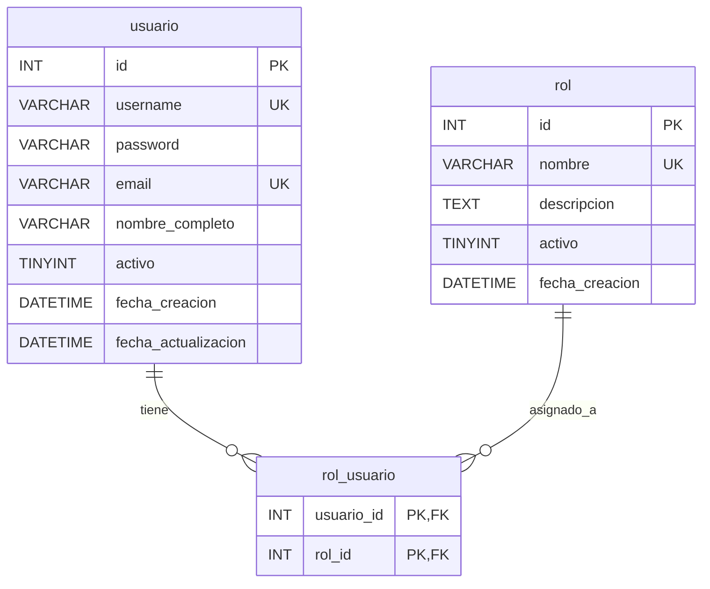

# Modelo de datos — v3: usuarios, roles y asignaciones

> **Fuente comprobada:** archivo `init(4).sql` recibido para esta revisión, sección «MÓDULO DE GESTIÓN DE USUARIOS», DDL de `rol`, `usuario` y `rol_usuario`. Esta sección describe el **SQL compartido**; su correspondencia con una base MariaDB ya inicializada se debe verificar con `SHOW CREATE TABLE`, dado que Docker no vuelve a ejecutar `init.sql` en un volumen existente. No se modifica el esquema heredado.

## 1. Tabla `rol`

| Columna | Tipo literal en `init.sql` | Restricción / valor inicial |
|---|---|---|
| `id` | `INT` | `AUTO_INCREMENT`, clave primaria |
| `nombre` | `VARCHAR(100)` | `NOT NULL`, `UNIQUE` |
| `descripcion` | `TEXT` | Admite `NULL` |
| `activo` | `TINYINT(1)` | `DEFAULT 1`; **admite `NULL`** (no se declaró `NOT NULL`) |
| `fecha_creacion` | `DATETIME` | `DEFAULT CURRENT_TIMESTAMP` |

La API de v3 podrá administrar roles. **Decisión documentada para v3:** añadir al `init.sql` los registros de rol `admin` y `consulta` con descripciones (no secretos), dejando a MariaDB generar sus IDs; la versión de SQL recibida **aún no contiene esos INSERT**. La base en ejecución puede tener roles preexistentes y se debe consultar antes de aplicar la inicialización.

## 2. Tabla `usuario`

| Columna | Tipo literal en `init.sql` | Restricción / valor inicial |
|---|---|---|
| `id` | `INT` | `AUTO_INCREMENT`, clave primaria |
| `username` | `VARCHAR(100)` | `NOT NULL`, `UNIQUE` |
| `password` | `VARCHAR(255)` | `NOT NULL`: **hash**, nunca clave en texto plano |
| `email` | `VARCHAR(150)` | `NOT NULL`, `UNIQUE` |
| `nombre_completo` | `VARCHAR(200)` | Admite `NULL` |
| `activo` | `TINYINT(1)` | `DEFAULT 1`; **admite `NULL`** |
| `fecha_creacion` | `DATETIME` | `DEFAULT CURRENT_TIMESTAMP` |
| `fecha_actualizacion` | `DATETIME` | `DEFAULT CURRENT_TIMESTAMP ON UPDATE CURRENT_TIMESTAMP` |

**Decisiones del contrato aún por aprobar:** identificación de login por username o email, reglas de cambio de contraseña, validaciones y cuáles campos de auditoría devolver. Tanto `id` como las fechas se generan en la base; el cliente no debe poder fijar `activo` ni fechas arbitrarias. `password_hash()` crea el valor a persistir y `password_verify()` sirve para autenticar. Nunca incluir `password` en JSON de salida.

## 3. Tabla `rol_usuario`

| Columna | Tipo literal | Restricciones |
|---|---|---|
| `usuario_id` | `INT NOT NULL` | FK a `usuario(id)`, participa en clave primaria |
| `rol_id` | `INT NOT NULL` | FK a `rol(id)`, participa en clave primaria |

**Clave primaria compuesta:** `(usuario_id, rol_id)`; la misma pareja no puede repetirse. **Ambas FK tienen `ON DELETE CASCADE`**: si se elimina físicamente un usuario o rol, MariaDB elimina sus asociaciones. El borrado lógico de `usuario` o `rol` **no activa** esta cascada.

No existen `id`, `activo` ni fechas en `rol_usuario`. No hay campos no identificadores para modificar en PUT/PATCH. **C8 sigue abierta**: decidir si desasignar un rol mediante DELETE físico de la relación (sin modificar las fichas principales), o solicitar y documentar una ampliación del esquema para borrado lógico; el script no resuelve esa decisión. Es coherente proponer `405` para PUT/PATCH de la asociación, siguiendo las cinco tablas puente simples de v2, pero se debe aprobar en la spec.

## 4. Relaciones reales



Esta es una relación muchos a muchos, con registro de asignación identificable por ambos IDs. Los atributos `participa_grupo.rol` y `participa_semillero.rol` son roles de participación científica y **no** definen permisos de seguridad.

## 5. Datos iniciales y arranque del primer administrador

- El SQL entregado **no contiene INSERT para** `rol`, `usuario` ni `rol_usuario`: el esquema por sí solo no crea un administrador.
- La ausencia de INSERT en el archivo **no prueba que una base MariaDB ya utilizada esté vacía**: comprobar con `SELECT COUNT(*)` en el entorno real.
- **C5: decisión de diseño registrada:** el nuevo `init.sql` sembrará solo `admin` y `consulta`. Un script PHP independiente, solo consola, obtendrá las credenciales del entorno y creará el primer `usuario` con hash y la relación `rol_usuario`. No hay `id` ni contraseña fija de administrador en el SQL.
- **Control en volumen existente:** `init.sql` solo se ejecuta al crear el volumen. El mismo procedimiento de bootstrap deberá asegurar roles idempotentemente por nombre en instalaciones previas, sin usar `down -v`; si detecta un administrador válido, no toca su contraseña ni añade otro.
- **Control ante datos ambiguos:** un usuario existente con mismo username/email pero sin privilegios no se promueve automáticamente a admin; el procedimiento se detiene. Toda consulta operativa de permisos requiere usuario y rol activos (`activo = 1`).
- En lectura y autorización se recomienda considerar activo **solo si `activo = 1`**. La API no debe confiar en `NULL` ni otorgar permisos por valores ambiguos. El contrato debe impedir escribir `activo` manualmente desde el frontend.

### Especificación del delta de semillas (NO ejecutado)

El nuevo bloque que **se propone** añadir a `db/init.sql` es:

```sql
-- [C6] V3: roles de seguridad iniciales; datos públicos, sin credenciales.
INSERT INTO rol (nombre, descripcion) VALUES
    ('admin', 'Administrador del sistema'),
    ('consulta', 'Usuario con permisos de lectura');
```

**Nota:** `[C6]` es un número provisional; el equipo debe asignar el siguiente número libre según la cabecera vigente y evitar confundirlo con la clarificación C6 del JWT. El `init.sql` actual documenta cinco ajustes previos. Esta sentencia se ejecutaría en el primer arranque de un volumen nuevo; **no garantiza** la actualización de un volumen existente, donde deberá existir una ruta de inserción idempotente sin duplicados.

Variables de entorno **propuestas para un proceso de inicialización temporal**: `ADMIN_INICIAL_USERNAME`, `ADMIN_INICIAL_EMAIL` y `ADMIN_INICIAL_PASSWORD`. No forman parte de la tabla; nunca almacenar o enviar la contraseña en la respuesta de la API. Los ID de la asignación se obtienen de INSERT/SELECT reales.

## 6. JWT y autorización (no son columnas SQL)

**Formato mínimo de claims propuesto:**

```json
{
  "sub": "<id-de-usuario-como-cadena>",
  "iat": 0,
  "exp": 0
}
```

Los ceros son marcadores ilustrativos, **no fechas reales**. La duración del JWT, su conjunto de claims y si se consulta `rol_usuario` con `rol.activo = 1` y `usuario.activo = 1` en cada petición siguen pendientes de aprobación (C6). El frontend conserva el token en su sesión PHP y no tiene acceso a esta base mediante PDO.

## 7. Verificaciones de esquema y consistencia para el entorno real

```sql
SHOW CREATE TABLE usuario;
SHOW CREATE TABLE rol;
SHOW CREATE TABLE rol_usuario;
SELECT COUNT(*) AS total_usuarios FROM usuario;
SELECT COUNT(*) AS total_roles FROM rol;
SELECT COUNT(*) AS total_asignaciones FROM rol_usuario;
```

Estas consultas **no alteran datos**. No ejecutar `docker compose down -v` en un proyecto con información que deba conservarse: elimina los volúmenes y puede borrar la base de datos persistida.

**Estado:** DDL del `init.sql` identificado; C3 (semillas) y C5 (diseño de bootstrap) cuentan con decisiones registradas, todavía sin ejecutar. Los demás detalles de C3–C11 y la comprobación de la base instalada siguen pendientes.

## 8. Matriz de invariantes del SQL para los CRUD administrativos

| Operación | Restricción exacta comprobada en `init(4).sql` | Prueba esperada |
|---|---|---|
| POST de usuario | `username UNIQUE`, `email UNIQUE`, `password NOT NULL` | Duplicado → 409; contraseña almacenada solo como hash |
| POST de rol | `nombre UNIQUE NOT NULL` | Duplicado → 409; `id` generado por la base |
| POST de asignación | PK `(usuario_id, rol_id)` y dos FK | Duplicado → 409; FK inexistente → conflicto documentado |
| Retiro de usuario/rol | Campo `activo` existente, pero nullable en DDL | Solo `activo = 1` concede acceso; retirada lógica conserva fila |
| Retiro de asignación | No existe campo `activo`; `ON DELETE CASCADE` solo para bajas físicas de padres | **Pendiente C8:** decidir excepcionar DELETE físico del vínculo o migrar esquema con aprobación |
| Actualización de asignación | Dos columnas, ambas integrantes de la PK | **Pendiente C8:** definir reemplazo transaccional o `405` como en las asociaciones V2 |

**Verificación de base utilizada:** lo anterior se comprobó contra el archivo adjunto `init(4).sql`, NO contra un volumen Docker en funcionamiento. Para una instalación con volumen persistente, los cambios en `init.sql` no se reproducen automáticamente. La inserción de los roles y el primer admin debe tener una operación idempotente que no dependa de ejecutar `down -v`.

### Revisión del orden de inicialización

1. Instalar o verificar la estructura sin forzar reinicialización destructiva.
2. Asegurar `rol.nombre = 'admin'` y `rol.nombre = 'consulta'` por su nombre `UNIQUE`, sin IDs fijos. Los INSERT simples del `init.sql` solo aplican al **primer arranque**.
3. Si no hay administrador activo, exigir credenciales no versionadas y crear usuario + vínculo en una transacción; si hay una cuenta coincidente pero sin rol, **detenerse**, no otorgar acceso automáticamente.
4. No almacenar la contraseña inicial en SQL, documentación, salidas de prueba o logs. Después del bootstrap, retirar la variable de bootstrap donde corresponda sin afectar `JWT_SECRET`, que sigue siendo requerido para la API.
