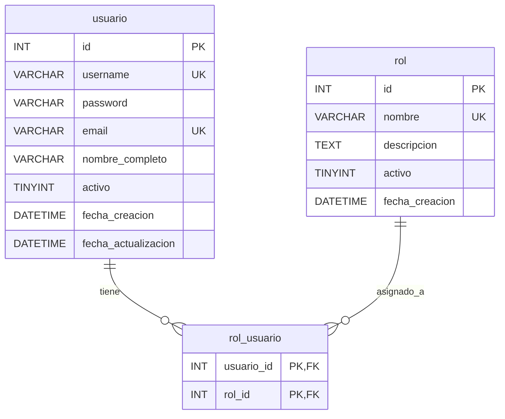

# Modelo de datos — v3: usuarios, roles y asignaciones

> **Actualización — 19-11-2026:** el esquema de las tres tablas no cambia. El catálogo funcional de `rol` queda limitado a los dos registros semilla `admin` y `consulta`; la API solo los consulta y no permite mutaciones. `activo` y `fecha_creacion` se conservan por el DDL, pero no son campos editables. El catálogo y su evidencia HTTP/frontend están en [REGISTRO_FASE7_CATALOGO_ROL_20261119.md](REGISTRO_FASE7_CATALOGO_ROL_20261119.md).

> **Seguimiento — 16-11-2026:** en una base **nueva y aislada** se constató `usuario` con una sola fila `ADMIN`, `activo=1`, vínculo con rol `admin` y longitud 60 de la columna de hash. El inicializador no duplicó cuentas al repetirse. La verificación integral `SHOW CREATE TABLE` sigue pendiente; estos SELECT **no** sustituyen una auditoría DDL ni un login contra esa base. Ver [REGISTRO_BOOTSTRAP_Y_LOGIN_DEMO_20261116.md](REGISTRO_BOOTSTRAP_Y_LOGIN_DEMO_20261116.md).

> **Actualización de evidencia — 12-11-2026, fase 5:** gestión principal de `rol_usuario` comprobada por **15/15** pruebas aisladas y HTTP real: asignación `201`, ficha `200`, duplicado `409`, retiro `200`, ficha posterior `404`. Un usuario `consulta` real obtuvo GET V1 `200`, POST V1 `403` y GET administrativo `403`; tras retirar el rol, **el mismo JWT** pasó a GET `403`. SQL confirmó usuario sin rol aún activo y `ADMIN` con `admin`. La protección del último administrador **queda pendiente de prueba final solo en base descartable**, sin arriesgar el volumen local. Ver [REGISTRO_FASE5_ROL_USUARIO.md](REGISTRO_FASE5_ROL_USUARIO.md).

> **Fuente comprobada:** archivo `init(4).sql` recibido para esta revisión, sección «MÓDULO DE GESTIÓN DE USUARIOS», DDL de `rol`, `usuario` y `rol_usuario`. Esta sección describe el **SQL compartido**; su correspondencia con una base MariaDB ya inicializada se debe verificar con `SHOW CREATE TABLE`, dado que Docker no vuelve a ejecutar `init.sql` en un volumen existente. No se modifica el esquema heredado.

> **Actualización al 12-11-2026:** roles y administrador inicial creados localmente; login real `ADMIN` exitoso con JWT de 3600 segundos (**15/15** pruebas automatizadas); autorización central con **28/28** pruebas automatizadas, HTTP **401** sin token y **200** con Bearer válido para `area_conocimiento`. Persisten pendientes idempotencia del bootstrap, instalación limpia, matriz HTTP completa, CRUD administrativos, frontend y regresión. La evidencia proviene del estudiante, no de acceso directo a su Docker. Véanse [REGISTRO_FASE1_ADMIN.md](REGISTRO_FASE1_ADMIN.md), [REGISTRO_FASE2_LOGIN.md](REGISTRO_FASE2_LOGIN.md), [REGISTRO_FASE3_MIDDLEWARE.md](REGISTRO_FASE3_MIDDLEWARE.md) y [7_quickstart.md](7_quickstart.md).
> **Contraste con registros reales de MariaDB (12-11-2026):** el estudiante observó dos filas de `usuario` (`ADMIN` activo y el usuario de prueba ID 2 con `activo=0`), ambas con prefijo de hash bcrypt `$2y$` y longitud 60; se contabilizó **un administrador activo** mediante JOIN de `usuario`, `rol_usuario` y `rol`. Estas comprobaciones **no sustituyen** un `SHOW CREATE TABLE` ni una auditoría exhaustiva de contraseñas; consultar [REGISTRO_FASE4_USUARIO.md](REGISTRO_FASE4_USUARIO.md).

## 1. Tabla `rol`

| Columna | Tipo literal en `init.sql` | Restricción / valor inicial |
|---|---|---|
| `id` | `INT` | `AUTO_INCREMENT`, clave primaria |
| `nombre` | `VARCHAR(100)` | `NOT NULL`, `UNIQUE` |
| `descripcion` | `TEXT` | Admite `NULL` |
| `activo` | `TINYINT(1)` | `DEFAULT 1`; **admite `NULL`** (no se declaró `NOT NULL`) |
| `fecha_creacion` | `DATETIME` | `DEFAULT CURRENT_TIMESTAMP` |

La tabla conserva su estructura original, pero la aplicación **no ofrece CRUD de roles**. El catálogo de acceso de v3 está formado por `admin` y `consulta`, sembrados por nombre (sin IDs fijos) y con descripciones no sensibles. La API solo permite listarlos y consultar una ficha; no admite crear, reemplazar, actualizar ni retirar roles. La columna `activo` permanece por compatibilidad con el DDL y se utiliza como filtro interno (`activo = 1`); no se recibe ni modifica desde el cliente. La prueba local del catálogo se registra en `REGISTRO_FASE7_CATALOGO_ROL_20261119.md`.

## 2. Tabla `usuario`

| Columna | Tipo literal en `init.sql` | Restricción / valor inicial |
|---|---|---|
| `id` | `INT` | `AUTO_INCREMENT`, clave primaria |
| `username` | `VARCHAR(100)` | `NOT NULL`, `UNIQUE` |
| `password` | `VARCHAR(255)` | `NOT NULL`: **hash**, nunca clave en texto plano |
| `email` | `VARCHAR(150)` | `NOT NULL`, `UNIQUE` |
| `nombre_completo` | `VARCHAR(200)` | Admite `NULL` |
| `activo` | `TINYINT(1)` | `DEFAULT 1`; **admite `NULL`** |
| `fecha_creacion` | `DATETIME` | `DEFAULT CURRENT_TIMESTAMP` |
| `fecha_actualizacion` | `DATETIME` | `DEFAULT CURRENT_TIMESTAMP ON UPDATE CURRENT_TIMESTAMP` |

**Decisiones funcionales aprobadas:** login por `username` y `password`; cambio de contraseña explícito y separado de la edición de perfil; las restricciones exactas de formularios y campos de auditoría se detallarán en los contratos. Tanto `id` como las fechas se generan en la base; el cliente no debe poder fijar `activo` ni fechas arbitrarias. `password_hash()` crea el valor a persistir y `password_verify()` sirve para autenticar. Nunca incluir `password` en JSON de salida.

## 3. Tabla `rol_usuario`

| Columna | Tipo literal | Restricciones |
|---|---|---|
| `usuario_id` | `INT NOT NULL` | FK a `usuario(id)`, participa en clave primaria |
| `rol_id` | `INT NOT NULL` | FK a `rol(id)`, participa en clave primaria |

**Clave primaria compuesta:** `(usuario_id, rol_id)`; la misma pareja no puede repetirse. **Ambas FK tienen `ON DELETE CASCADE`**: si se elimina físicamente un usuario o rol, MariaDB elimina sus asociaciones. El borrado lógico de `usuario` o `rol` **no activa** esta cascada.

No existen `id`, `activo` ni fechas en `rol_usuario`. No hay campos no identificadores para modificar en PUT/PATCH. **C8 aprobada por el equipo:** desasignar con DELETE físico **solo de `rol_usuario`**, sin eliminar usuario ni rol; `PUT/PATCH` de la asociación responden `405`, como otras asociaciones simples de v2. Hay que proteger al último administrador activo en el servicio. Esta política está implementada y probada en el flujo principal de asociaciones; **la protección del último administrador** aún requiere prueba real en base descartable.

## 4. Relaciones reales



Esta es una relación muchos a muchos, con registro de asignación identificable por ambos IDs. Los atributos `participa_grupo.rol` y `participa_semillero.rol` son roles de participación científica y **no** definen permisos de seguridad.

## 5. Datos iniciales y arranque del primer administrador

- El `init(4).sql` original **no contenía INSERT de seguridad**; en el `db/init.sql` modificado por el estudiante se añadieron únicamente `admin` y `consulta` como datos semilla del catálogo fijo, pero no se almacena ninguna cuenta administradora ni contraseña en SQL.
- La ausencia de INSERT en el archivo **no prueba que una base MariaDB ya utilizada esté vacía**: comprobar con `SELECT COUNT(*)` en el entorno real.
- **C5: diseño aprobado y ejecución local probada:** `init.sql` incluye las semillas fijas `admin` y `consulta`. Un script PHP solo consola obtiene las credenciales del entorno y crea el primer `usuario` con hash y la relación `rol_usuario`. No hay `id` ni contraseña fija de administrador en el SQL. La API no permite ampliar ni modificar el catálogo.
- **Control en volumen existente:** `init.sql` solo se ejecuta al crear el volumen. El mismo procedimiento de bootstrap deberá asegurar roles idempotentemente por nombre en instalaciones previas, sin usar `down -v`; si detecta un administrador válido, no toca su contraseña ni añade otro.
- **Control ante datos ambiguos:** un usuario existente con mismo username/email pero sin privilegios no se promueve automáticamente a admin; el procedimiento se detiene. Toda consulta operativa de permisos requiere usuario y rol activos (`activo = 1`).
- En lectura y autorización se recomienda considerar activo **solo si `activo = 1`**. La API no debe confiar en `NULL` ni otorgar permisos por valores ambiguos. El contrato debe impedir escribir `activo` manualmente desde el frontend.

### Especificación del delta de semillas (agregado al archivo local; probado en volumen aislado nuevo)

El nuevo bloque que **se propone** añadir a `db/init.sql` es:

```sql
-- ROLES INICIALES DEL SISTEMA - V3
INSERT INTO rol (nombre, descripcion, activo)
VALUES
    ('admin', 'Administrador del sistema', TRUE),
    ('consulta', 'Usuario con permisos de solo lectura', TRUE);
```

**Nota:** el bloque anterior es el que mostró `git diff` del estudiante. La actualización del encabezado numerado del SQL aún debe verificarse. La sentencia se ejecuta al inicializar un volumen nuevo; para uno existente, el script CLI PHP ya permite asegurar roles por nombre sin borrar el volumen.

Variables de entorno **implementadas para el proceso de inicialización CLI**: `ADMIN_INICIAL_USERNAME`, `ADMIN_INICIAL_EMAIL` y `ADMIN_INICIAL_PASSWORD`. El `docker-compose.yml` local ejecuta `inicializar-admin` tras MariaDB saludable. Estas variables no forman parte de ninguna tabla; nunca almacenar o enviar la contraseña en una respuesta de la API. Los ID de la asignación se obtienen de INSERT/SELECT reales.

## 6. JWT y autorización (no son columnas SQL)

**Formato mínimo de claims propuesto:**

```json
{
  "sub": "<id-de-usuario-como-cadena>",
  "iat": 0,
  "exp": 0
}
```

Los ceros son marcadores ilustrativos, **no fechas reales**. **Duración JWT aprobada:** `exp = iat + 3600` (60 minutos). La autorización consultará usuario, rol y asociación vigentes en la BD en cada solicitud protegida. Campos opcionales de claims pendientes de implementación, no de la duración. El frontend conserva el token en su sesión PHP y no tiene acceso a esta base mediante PDO.

## 7. Verificaciones de esquema y consistencia para el entorno real

```sql
SHOW CREATE TABLE usuario;
SHOW CREATE TABLE rol;
SHOW CREATE TABLE rol_usuario;
SELECT COUNT(*) AS total_usuarios FROM usuario;
SELECT COUNT(*) AS total_roles FROM rol;
SELECT COUNT(*) AS total_asignaciones FROM rol_usuario;
```

Estas consultas **no alteran datos**. No ejecutar `docker compose down -v` en un proyecto con información que deba conservarse: elimina los volúmenes y puede borrar la base de datos persistida.

**Estado:** DDL del `init.sql` identificado; C3 y C5 cuentan con acuerdo. Se observó el admin en la base habitual, se creó sobre un volumen aislado nuevo y se repitió el inicializador sin duplicar cuentas. El catálogo fijo `rol` quedó integrado como solo lectura y probado localmente el 19-11-2026. Faltan escenarios negativos, prueba de login de la instancia aislada y cotejo completo de estructura mediante `SHOW CREATE TABLE`; la regresión y la verificación completa de la base instalada continúan pendientes.

## 8. Matriz de invariantes del SQL y operaciones administrativas

| Operación | Restricción exacta comprobada en `init(4).sql` | Contrato / prueba |
|---|---|---|
| POST de usuario | `username UNIQUE`, `email UNIQUE`, `password NOT NULL` | Duplicado → 409; contraseña almacenada solo como hash |
| GET de rol | `nombre UNIQUE NOT NULL`; `id` autoincremental; `activo` filtra los registros visibles | Solo catálogo `admin`/`consulta`; GET colección/ficha para admin |
| POST/PUT/PATCH/DELETE de rol | El DDL permite persistencia, pero el contrato de aplicación no expone mutaciones | `405` y `Allow: GET`; no existe alta, edición ni retiro desde la API |
| POST de asignación | PK `(usuario_id, rol_id)` y dos FK | Duplicado → 409; FK inexistente → conflicto documentado |
| Retiro de usuario | Campo `activo` existente, nullable en DDL | Solo `activo = 1` concede acceso; retirada lógica conserva fila |
| Retiro de rol | La columna `activo` permanece en el esquema | No existe operación de retiro en la API; el catálogo se mantiene fijo |
| Retiro de asignación | No existe campo `activo`; `ON DELETE CASCADE` solo para bajas físicas de padres | **Acordado C8:** DELETE físico solo del vínculo |
| Actualización de asignación | Dos columnas, ambas integrantes de la PK | **Acordado C8:** PUT/PATCH `405` |

**Verificación de base utilizada:** DDL verificado documentalmente en `init(4).sql`; los `SELECT` de rol y asignación de administrador **sí se realizaron** en la BD local, pero todavía falta comparar las tablas completas con `SHOW CREATE TABLE`. Para una instalación con volumen persistente, los cambios en `init.sql` no se reproducen automáticamente. La inserción de los roles y el primer admin debe tener una operación idempotente que no dependa de ejecutar `down -v`.

### Revisión del orden de inicialización

1. Instalar o verificar la estructura sin forzar reinicialización destructiva.
2. Asegurar `rol.nombre = 'admin'` y `rol.nombre = 'consulta'` por su nombre `UNIQUE`, sin IDs fijos. Los INSERT simples del `init.sql` solo aplican al **primer arranque**.
3. Si no hay administrador activo, exigir credenciales no versionadas y crear usuario + vínculo en una transacción; si hay una cuenta coincidente pero sin rol, **detenerse**, no otorgar acceso automáticamente.
4. No almacenar la contraseña inicial en SQL, documentación, salidas de prueba o logs. Después del bootstrap, retirar la variable de bootstrap donde corresponda sin afectar `JWT_SECRET`, que sigue siendo requerido para la API.
