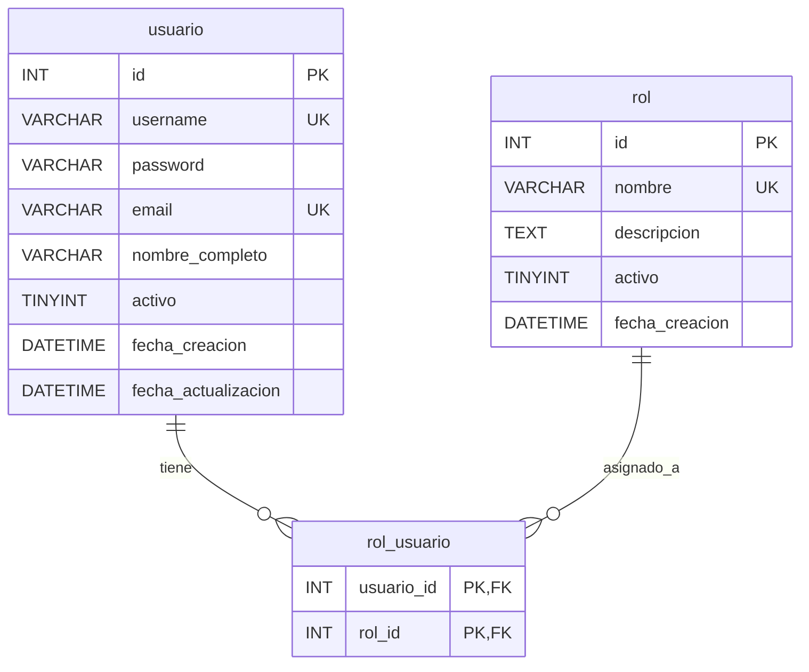

# Modelo de datos — v3: usuarios, roles y asignaciones

> **Fuente comprobada:** archivo `init(4).sql` recibido para esta revisión, sección «MÓDULO DE GESTIÓN DE USUARIOS», DDL de `rol`, `usuario` y `rol_usuario`. Esta sección describe el **SQL compartido**; su correspondencia con una base MariaDB ya inicializada se debe verificar con `SHOW CREATE TABLE`, dado que Docker no vuelve a ejecutar `init.sql` en un volumen existente. No se modifica el esquema heredado.

> **Actualización al 12-11-2026:** roles y administrador inicial creados localmente; login real `ADMIN` exitoso con JWT de 3600 segundos (**15/15** pruebas automatizadas); autorización central con **28/28** pruebas automatizadas, HTTP **401** sin token y **200** con Bearer válido para `area_conocimiento`. Persisten pendientes idempotencia del bootstrap, instalación limpia, matriz HTTP completa, CRUD administrativos, frontend y regresión. La evidencia proviene del estudiante, no de acceso directo a su Docker. Véanse [REGISTRO_FASE1_ADMIN.md](REGISTRO_FASE1_ADMIN.md), [REGISTRO_FASE2_LOGIN.md](REGISTRO_FASE2_LOGIN.md), [REGISTRO_FASE3_MIDDLEWARE.md](REGISTRO_FASE3_MIDDLEWARE.md) y [7_quickstart.md](7_quickstart.md).
## 1. Tabla `rol`

| Columna | Tipo literal en `init.sql` | Restricción / valor inicial |
|---|---|---|
| `id` | `INT` | `AUTO_INCREMENT`, clave primaria |
| `nombre` | `VARCHAR(100)` | `NOT NULL`, `UNIQUE` |
| `descripcion` | `TEXT` | Admite `NULL` |
| `activo` | `TINYINT(1)` | `DEFAULT 1`; **admite `NULL`** (no se declaró `NOT NULL`) |
| `fecha_creacion` | `DATETIME` | `DEFAULT CURRENT_TIMESTAMP` |

La API de v3 podrá administrar roles. **Decisión documentada para v3:** añadir al `init.sql` los registros de rol `admin` y `consulta` con descripciones (no secretos), dejando a MariaDB generar sus IDs; el estudiante **ya añadió** estos `INSERT` a su `db/init.sql` en la rama de v3; su ejecución en un volumen completamente nuevo **no se ha probado**. La base en ejecución puede tener roles preexistentes y se debe consultar antes de aplicar la inicialización.

## 2. Tabla `usuario`

| Columna | Tipo literal en `init.sql` | Restricción / valor inicial |
|---|---|---|
| `id` | `INT` | `AUTO_INCREMENT`, clave primaria |
| `username` | `VARCHAR(100)` | `NOT NULL`, `UNIQUE` |
| `password` | `VARCHAR(255)` | `NOT NULL`: **hash**, nunca clave en texto plano |
| `email` | `VARCHAR(150)` | `NOT NULL`, `UNIQUE` |
| `nombre_completo` | `VARCHAR(200)` | Admite `NULL` |
| `activo` | `TINYINT(1)` | `DEFAULT 1`; **admite `NULL`** |
| `fecha_creacion` | `DATETIME` | `DEFAULT CURRENT_TIMESTAMP` |
| `fecha_actualizacion` | `DATETIME` | `DEFAULT CURRENT_TIMESTAMP ON UPDATE CURRENT_TIMESTAMP` |

**Decisiones funcionales aprobadas:** login por `username` y `password`; cambio de contraseña explícito y separado de la edición de perfil; las restricciones exactas de formularios y campos de auditoría se detallarán en los contratos. Tanto `id` como las fechas se generan en la base; el cliente no debe poder fijar `activo` ni fechas arbitrarias. `password_hash()` crea el valor a persistir y `password_verify()` sirve para autenticar. Nunca incluir `password` en JSON de salida.

## 3. Tabla `rol_usuario`

| Columna | Tipo literal | Restricciones |
|---|---|---|
| `usuario_id` | `INT NOT NULL` | FK a `usuario(id)`, participa en clave primaria |
| `rol_id` | `INT NOT NULL` | FK a `rol(id)`, participa en clave primaria |

**Clave primaria compuesta:** `(usuario_id, rol_id)`; la misma pareja no puede repetirse. **Ambas FK tienen `ON DELETE CASCADE`**: si se elimina físicamente un usuario o rol, MariaDB elimina sus asociaciones. El borrado lógico de `usuario` o `rol` **no activa** esta cascada.

No existen `id`, `activo` ni fechas en `rol_usuario`. No hay campos no identificadores para modificar en PUT/PATCH. **C8 aprobada por el equipo:** desasignar con DELETE físico **solo de `rol_usuario`**, sin eliminar usuario ni rol; `PUT/PATCH` de la asociación responden `405`, como otras asociaciones simples de v2. Hay que proteger al último administrador activo en el servicio. Esta política aún **no está implementada/probada** en el CRUD administrativo.

## 4. Relaciones reales



Esta es una relación muchos a muchos, con registro de asignación identificable por ambos IDs. Los atributos `participa_grupo.rol` y `participa_semillero.rol` son roles de participación científica y **no** definen permisos de seguridad.

## 5. Datos iniciales y arranque del primer administrador

- El `init(4).sql` original **no contenía INSERT de seguridad**; en el `db/init.sql` modificado por el estudiante ya se añadieron `admin` y `consulta` como datos semilla, pero no se almacena ninguna cuenta administradora ni contraseña en SQL.
- La ausencia de INSERT en el archivo **no prueba que una base MariaDB ya utilizada esté vacía**: comprobar con `SELECT COUNT(*)` en el entorno real.
- **C5: diseño aprobado y primera ejecución manual satisfactoria:** `init.sql` ya incluye las semillas `admin` y `consulta` en la rama del estudiante. Un script PHP solo consola obtuvo las credenciales del entorno y creó el primer `usuario` con hash y la relación `rol_usuario`. No hay `id` ni contraseña fija de administrador en el SQL.
- **Control en volumen existente:** `init.sql` solo se ejecuta al crear el volumen. El mismo procedimiento de bootstrap deberá asegurar roles idempotentemente por nombre en instalaciones previas, sin usar `down -v`; si detecta un administrador válido, no toca su contraseña ni añade otro.
- **Control ante datos ambiguos:** un usuario existente con mismo username/email pero sin privilegios no se promueve automáticamente a admin; el procedimiento se detiene. Toda consulta operativa de permisos requiere usuario y rol activos (`activo = 1`).
- En lectura y autorización se recomienda considerar activo **solo si `activo = 1`**. La API no debe confiar en `NULL` ni otorgar permisos por valores ambiguos. El contrato debe impedir escribir `activo` manualmente desde el frontend.

### Especificación del delta de semillas (agregado al archivo local; arranque limpio no probado)

El nuevo bloque que **se propone** añadir a `db/init.sql` es:

```sql
-- ROLES INICIALES DEL SISTEMA - V3
INSERT INTO rol (nombre, descripcion, activo)
VALUES
    ('admin', 'Administrador del sistema', TRUE),
    ('consulta', 'Usuario con permisos de solo lectura', TRUE);
```

**Nota:** el bloque anterior es el que mostró `git diff` del estudiante. La actualización del encabezado numerado del SQL aún debe verificarse. La sentencia se ejecuta al inicializar un volumen nuevo; para uno existente, el script CLI PHP ya permite asegurar roles por nombre sin borrar el volumen.

Variables de entorno **propuestas para un proceso de inicialización temporal**: `ADMIN_INICIAL_USERNAME`, `ADMIN_INICIAL_EMAIL` y `ADMIN_INICIAL_PASSWORD`. No forman parte de la tabla; nunca almacenar o enviar la contraseña en la respuesta de la API. Los ID de la asignación se obtienen de INSERT/SELECT reales.

## 6. JWT y autorización (no son columnas SQL)

**Formato mínimo de claims propuesto:**

```json
{
  "sub": "<id-de-usuario-como-cadena>",
  "iat": 0,
  "exp": 0
}
```

Los ceros son marcadores ilustrativos, **no fechas reales**. **Duración JWT aprobada:** `exp = iat + 3600` (60 minutos). La autorización consultará usuario, rol y asociación vigentes en la BD en cada solicitud protegida. Campos opcionales de claims pendientes de implementación, no de la duración. El frontend conserva el token en su sesión PHP y no tiene acceso a esta base mediante PDO.

## 7. Verificaciones de esquema y consistencia para el entorno real

```sql
SHOW CREATE TABLE usuario;
SHOW CREATE TABLE rol;
SHOW CREATE TABLE rol_usuario;
SELECT COUNT(*) AS total_usuarios FROM usuario;
SELECT COUNT(*) AS total_roles FROM rol;
SELECT COUNT(*) AS total_asignaciones FROM rol_usuario;
```

Estas consultas **no alteran datos**. No ejecutar `docker compose down -v` en un proyecto con información que deba conservarse: elimina los volúmenes y puede borrar la base de datos persistida.

**Estado:** DDL del `init.sql` identificado; C3 y C5 aprobadas. La creación inicial ya se ejecutó manualmente y se observaron los roles y el admin en MariaDB; falta repetición, instalación limpia y cotejo completo de estructura por `SHOW CREATE TABLE`. Siguen pendientes algunos detalles técnicos del frontend/contratos, la regresión y la comprobación DDL completa de la base instalada.

## 8. Matriz de invariantes del SQL para los CRUD administrativos

| Operación | Restricción exacta comprobada en `init(4).sql` | Prueba esperada |
|---|---|---|
| POST de usuario | `username UNIQUE`, `email UNIQUE`, `password NOT NULL` | Duplicado → 409; contraseña almacenada solo como hash |
| POST de rol | `nombre UNIQUE NOT NULL` | Duplicado → 409; `id` generado por la base |
| POST de asignación | PK `(usuario_id, rol_id)` y dos FK | Duplicado → 409; FK inexistente → conflicto documentado |
| Retiro de usuario/rol | Campo `activo` existente, pero nullable en DDL | Solo `activo = 1` concede acceso; retirada lógica conserva fila |
| Retiro de asignación | No existe campo `activo`; `ON DELETE CASCADE` solo para bajas físicas de padres | **Acordado C8:** DELETE físico solo del vínculo; por implementar |
| Actualización de asignación | Dos columnas, ambas integrantes de la PK | **Acordado C8:** PUT/PATCH `405`; por implementar |

**Verificación de base utilizada:** DDL verificado documentalmente en `init(4).sql`; los `SELECT` de rol y asignación de administrador **sí se realizaron** en la BD local, pero todavía falta comparar las tablas completas con `SHOW CREATE TABLE`. Para una instalación con volumen persistente, los cambios en `init.sql` no se reproducen automáticamente. La inserción de los roles y el primer admin debe tener una operación idempotente que no dependa de ejecutar `down -v`.

### Revisión del orden de inicialización

1. Instalar o verificar la estructura sin forzar reinicialización destructiva.
2. Asegurar `rol.nombre = 'admin'` y `rol.nombre = 'consulta'` por su nombre `UNIQUE`, sin IDs fijos. Los INSERT simples del `init.sql` solo aplican al **primer arranque**.
3. Si no hay administrador activo, exigir credenciales no versionadas y crear usuario + vínculo en una transacción; si hay una cuenta coincidente pero sin rol, **detenerse**, no otorgar acceso automáticamente.
4. No almacenar la contraseña inicial en SQL, documentación, salidas de prueba o logs. Después del bootstrap, retirar la variable de bootstrap donde corresponda sin afectar `JWT_SECRET`, que sigue siendo requerido para la API.
